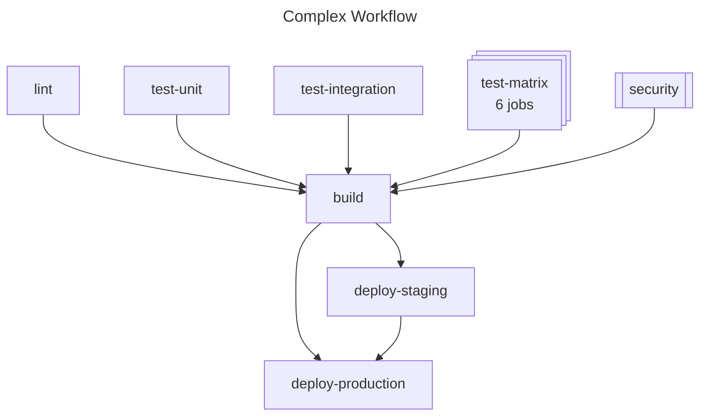

# GitHub Actions workflow --> Mermaid (`gh-wf2mmd`)

A [GitHub CLI](https://cli.github.com/) extension that draws GitHub Actions workflows as [Mermaid](https://mermaid.js.org/) flowcharts, ready to drop into a README, pull request, issue, or wiki page.



_Generated from [examples/complex.yml](examples/complex.yml). See the same workflow at the [detailed level](examples/complex-detailed.md)._

## Installation

```bash
gh extension install stebje/gh-wf2mmd
```

## Usage

```bash
# Print the diagram
gh wf2mmd .github/workflows/ci.yml

# Write a Markdown file with the diagram in a mermaid code block
gh wf2mmd .github/workflows/ci.yml -o docs/ci.md

# Preview what would be written, without writing anything
gh wf2mmd .github/workflows/ci.yml -o docs/ci.md --dry-run

# Add triggers, conditions, runners, environments and steps, laid out left to right
gh wf2mmd .github/workflows/ci.yml --level detailed --direction LR

# Draw a workflow from any repository you can read, without cloning it
gh api repos/OWNER/REPO/contents/.github/workflows/ci.yml \
  -H "Accept: application/vnd.github.raw" | gh wf2mmd -
```

| Flag | Default | Description |
|------|---------|-------------|
| `-o`, `--output <file>` | stdout | Write to a file. `.md` and `.markdown` files get the diagram inside a `mermaid` code block; any other file gets plain Mermaid. |
| `-l`, `--level <level>` | `simple` | Level of detail: `simple` or `detailed` (see below). |
| `-d`, `--direction <dir>` | `TB` | `TB` (top to bottom) or `LR` (left to right). |
| `--dry-run` | | Print what `--output` would contain instead of writing it. |

Flags can go before or after the workflow file. Pass `-` as the file to read the workflow from stdin. The output is deterministic, so regenerating a diagram for an unchanged workflow produces no diff.

### Detail levels

- **`simple`** shows the jobs and the `needs` dependencies between them: the shape of the workflow at a glance.
- **`detailed`** also shows the events that trigger the workflow, each job's `runs-on`, `environment`, `if` condition and called reusable workflow, and its steps (by name, action, or the first line of the script). Long conditions and scripts are shortened to keep nodes readable.

### Reading the diagram

| Element | Meaning |
|---------|---------|
| Rectangle | A job, labeled with its `name` (or its ID if it has no name) |
| Stacked rectangles | A matrix job, with the number of jobs it expands to, or just "matrix" if the matrix is computed at runtime |
| Rectangle with side bars | A job that calls a reusable workflow (`uses:`) |
| Rounded box (detailed) | The events that trigger the workflow |
| Dotted arrow (detailed) | The job only runs when its `if` condition holds |

### Viewing the output

- **GitHub** renders `mermaid` code blocks in Markdown files, issues, pull requests, discussions and wikis, so `-o something.md` produces a file that renders as a diagram on GitHub.
- **[mermaid.live](https://mermaid.live)** previews plain output and exports it as SVG or PNG: `gh wf2mmd ci.yml | pbcopy` (macOS), then paste.
- **VS Code** previews `.md` output with an extension such as [Markdown Preview Mermaid Support](https://marketplace.visualstudio.com/items?itemName=bierner.markdown-mermaid).

## Development

Requires Go 1.23.3 or later.

```bash
go build                 # build ./gh-wf2mmd
go test ./...            # run the tests
go test . -update        # regenerate the example diagrams after changing the output
gh extension install .   # use your local build as `gh wf2mmd`
```

```
main.go             CLI: flags, input and output
internal/workflow/  Parses workflow YAML: jobs, needs, matrix, triggers, steps
internal/mermaid/   Draws a parsed workflow as a Mermaid flowchart
examples/           Sample workflows and their diagrams, also used as golden test files
```

Pushing a `v*` tag publishes a release with binaries for all platforms through [cli/gh-extension-precompile](https://github.com/cli/gh-extension-precompile).

## Contributing

Contributions are welcome! Please feel free to submit a Pull Request.

1. Fork the repository
2. Create your feature branch (`git checkout -b feature/amazing-feature`)
3. Write tests for your changes
4. Ensure all tests pass (`go test ./...`)
5. Commit your changes (`git commit -m 'Add amazing feature'`)
6. Push to the branch (`git push origin feature/amazing-feature`)
7. Open a Pull Request

## License

[MIT License](LICENSE)

## Author / Maintainer

**Steffen Bjerkenås** ([@stebje](https://github.com/stebje))

## Acknowledgments

- Built with the [GitHub CLI](https://cli.github.com/)
- Generates diagrams for [Mermaid](https://mermaid.js.org/)
- Inspired by the need to visualize complex GitHub Actions workflows
