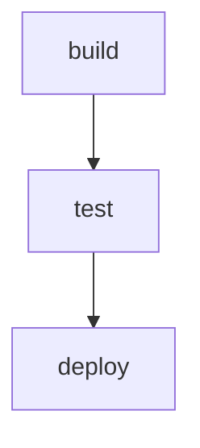
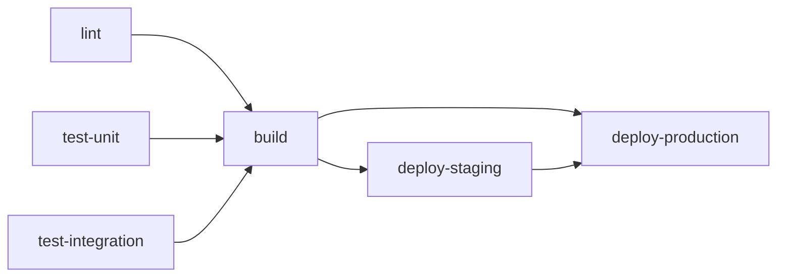

# gh-wf-to-mmd

A GitHub CLI extension that converts GitHub Actions workflow files into Mermaid diagrams.

## Overview

`gh-wf-to-mmd` takes a GitHub Actions workflow YAML file and generates a Mermaid flowchart diagram that visualizes the job dependencies and workflow structure. Perfect for documentation, presentations, or understanding complex workflows at a glance.

## Installation

### As a GitHub CLI Extension

```bash
gh extension install stebje/gh-wf-to-mmd
```

### Manual Installation

```bash
git clone https://github.com/stebje/gh-wf-to-mmd.git
cd gh-wf-to-mmd
go build
```

## Usage

### Basic Usage

```bash
# Output to stdout
gh wf-to-mmd path/to/workflow.yml

# Output to file
gh wf-to-mmd --output diagram.mmd path/to/workflow.yml

# Left-to-right orientation
gh wf-to-mmd --orientation LR path/to/workflow.yml
```

### Options

| Flag | Default | Description |
|------|---------|-------------|
| `--level` | `simple` | Detail level (currently only `simple` supported) |
| `--output` | `-` | Output file path (`-` for stdout) |
| `--orientation` | `TB` | Flowchart orientation (`TB` for top-to-bottom, `LR` for left-to-right) |

## Examples

### Simple Linear Workflow

**Input:** [`examples/simple.yml`](examples/simple.yml)

```yaml
jobs:
  build:
    runs-on: ubuntu-latest
  test:
    needs: build
    runs-on: ubuntu-latest
  deploy:
    needs: test
    runs-on: ubuntu-latest
```

**Command:**
```bash
gh wf-to-mmd examples/simple.yml
```

**Output:**


### Complex Workflow with Parallel Jobs

**Input:** [`examples/complex.yml`](examples/complex.yml)

```yaml
jobs:
  lint:
    runs-on: ubuntu-latest
  test-unit:
    runs-on: ubuntu-latest
  test-integration:
    runs-on: ubuntu-latest
  build:
    needs: [lint, test-unit, test-integration]
    runs-on: ubuntu-latest
  deploy-staging:
    needs: build
    runs-on: ubuntu-latest
  deploy-production:
    needs: [build, deploy-staging]
    runs-on: ubuntu-latest
```

**Command:**
```bash
gh wf-to-mmd --orientation LR examples/complex.yml
```

**Output:**


## Viewing Mermaid Diagrams

### Option 1: Mermaid Live Editor

Copy the output and paste it into [mermaid.live](https://mermaid.live)

```bash
gh wf-to-mmd workflow.yml | pbcopy
```

### Option 2: VS Code

Install the [Mermaid Preview extension](https://marketplace.visualstudio.com/items?itemName=bierner.markdown-mermaid) and save to a `.mmd` or `.md` file:

```bash
gh wf-to-mmd --output diagram.mmd workflow.yml
code diagram.mmd
```

### Option 3: GitHub Markdown

Save to a markdown file with mermaid code blocks:

````bash
echo '```mermaid' > diagram.md
gh wf-to-mmd workflow.yml >> diagram.md
echo '```' >> diagram.md
````

Then view on GitHub!

## Features

### Current Features (v0.1.0)

- ✅ Parse GitHub Actions workflow YAML files
- ✅ Generate Mermaid flowchart diagrams
- ✅ Visualize job dependencies (`needs`)
- ✅ Support for multiple dependencies (fan-in/fan-out patterns)
- ✅ Configurable orientation (TB/LR)
- ✅ Output to stdout or file

### Planned Features

- 🔄 `--level normal`: Include job metadata (runs-on, conditions)
- 🔄 `--level detailed`: Include step information
- 🔄 Workflow trigger visualization
- 🔄 Matrix strategy support
- 🔄 Conditional job visualization (`if:` conditions)
- 🔄 Reusable workflow support

## Development

### Prerequisites

- Go 1.23.3 or later

### Building

```bash
go build
```

### Testing

```bash
# Run all tests
go test ./...

# Run with verbose output
go test ./... -v

# Run with coverage
go test ./... -cover

# Generate coverage report
go test ./... -coverprofile=coverage.out
go tool cover -html=coverage.out
```

### Project Structure

```
gh-wf-to-mmd/
├── models/           # Data structures for workflows
├── parser/           # YAML parsing logic
├── transformer/      # Mermaid diagram generation
├── renderer/         # Output handling
├── examples/         # Example workflow files
└── main.go          # CLI entry point
```

### Adding New Features

1. Write tests first in the appropriate `*_test.go` file
2. Run tests: `go test ./... -v`
3. Implement the feature
4. Verify tests pass
5. Check coverage: `go test ./... -cover`

## Contributing

Contributions are welcome! Please feel free to submit a Pull Request.

1. Fork the repository
2. Create your feature branch (`git checkout -b feature/amazing-feature`)
3. Write tests for your changes
4. Ensure all tests pass (`go test ./...`)
5. Commit your changes (`git commit -m 'Add amazing feature'`)
6. Push to the branch (`git push origin feature/amazing-feature`)
7. Open a Pull Request

## License

[MIT License](LICENSE)

## Author / Maintainer

**Steffen Bjerkenås** ([@stebje](https://github.com/stebje))

## Acknowledgments

- Built with the [GitHub CLI](https://cli.github.com/)
- Generates diagrams for [Mermaid](https://mermaid.js.org/)
- Inspired by the need to visualize complex GitHub Actions workflows

---

**Note:** This tool currently supports simple job dependency visualization. More advanced features (steps, conditions, triggers) are planned for future releases.
